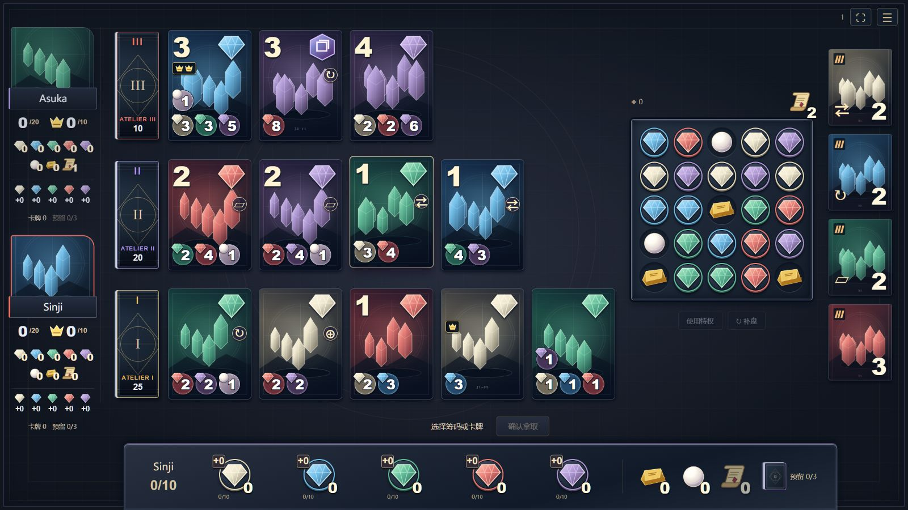

# Duel Atelier · 对决工坊

A free, open-source two-player strategy game and AI analysis sandbox, with local and online play.
非官方的 Splendor Duel 基础版规则实现，供学习、研究、双人同机及网上联机对战参考。



## 快速开始

需要 **Node.js 24+**。[Release](https://github.com/Akira-suka/duel-atelier/releases/latest)
提供已构建包：解压后双击 `play-built.cmd`，打开 `http://127.0.0.1:4173/`，无需安装 npm 依赖。
开发与修改则下载源码 ZIP，或：

```powershell
git clone https://github.com/Akira-suka/duel-atelier.git
cd duel-atelier
npm ci
npm run dev
```

打开终端显示的 localhost 地址。Windows 安装依赖后可双击 `start.cmd`。
无需账号、在线图片、付费 API 或模型下载。关闭终端即停止服务。

```powershell
npm run check      # 素材/类型/测试/生产构建
npm run build
npm run preview
```

推荐电脑横屏。浏览器本地自动保存对局与已完成的分析样本，支持 JSON 导入/导出；
刷新后可继续兼容的分析，删除浏览器数据会删除存档。重要对局请导出 JSON 备份。

## 网上双人联机（v0.4）

**房主用自己的电脑开服，朋友只需浏览器，不需要购买域名或租服务器。**

Windows 下载源码、安装 Node.js 24+ 后，双击 `host-friends.cmd`：

1. 选择「Public invite」供不同网络的朋友游玩；首次自动下载并校验 Cloudflare 官方便携隧道工具，不需要账号或域名。
2. 房主打开终端显示的本机地址并创建房间。
3. 将终端显示的临时 HTTPS 网址和网页里的邀请码一起发给朋友。

同一网络可选「LAN only」；Cloudflare 无法连接时选「Public invite via SSH」，使用系统 OpenSSH 客户端连接备用免费隧道。
命令行对应 `npm run host:public` / `npm run host:lan` / `npm run host:ssh`（先 `npm ci`、`npm run build`）。
房主保持电脑和窗口运行；停止后临时网址失效，下次开服通常会换网址。继续旧局前请双方保存「重连凭证」。
Quick Tunnel 是第三方临时服务，网络可达性与稳定性不保证；局域网方式不依赖它。
保留原有同机模式。支持断线重连、主机重启恢复、SQLite 存档；完整回放仅在终局开放。
开服、恢复与数据保留详见 [ONLINE.md](docs/ONLINE.md)。

## 已实现

- 同机热座、私人预留牌遮挡、三种获胜条件和完整卡牌能力流程。
- 卡牌、资源与付款动画；可购买卡牌金光；单次提交防重复。
- 每个执行动作的记录与终局回放，历史牌市、资源和双方状态同步查看。
- 快速基线与战术＋MCTS 搜索复核，两种胜率独立计算与缓存。
- 对局期间后台预计算，胜率只在终局回放展示；菜单可关闭预计算。
- 渐进采样：先 8 次，再 24 次；优先当前步骤，可单步增至 64 次；复用后台结果。
- 全局一个分析 Worker、一个在途局面；动画和页面隐藏时暂停，按需重建历史局面。
- 分析样本随存档保存，刷新或导入后核验局面与策略版本，再从未完成的样本继续。
- 最近已完成对局自动归档；历史回放不覆盖当前对局。
- 确定性规则引擎、存档校验及可复现测试。
- 邀请码联机、服务端裁定、请求去重、按玩家过滤隐藏信息、终局回放下载。
- 回放红蓝操作背景、候选行动比较与整局表现参考分（新增评价目前仅页面内缓存）。

当前模拟胜率取决于模拟策略，并非经过真人对局校准的概率。
旧版纯局面存档可以继续游戏，但无法恢复导入前的行动历史。

v0.3 的历史归档最多保留 **5 局**，归档 JSON 合计不超过 **1.5 MB**（按 UTF-8 计量），
达到上限时淘汰较旧记录，可能少于 5 局；单局存档上限为 2 MB。
浏览器存储配额和实际磁盘开销另计，自动保存不能代替导出备份。
升级前已经被新对局覆盖的旧记录无法恢复；升级后完成并成功写入的对局按上述上限保留。

v0.2 独立验收：新策略对旧策略 **54 胜 10 负**（32 个种子换边、共 64 局）；
24 个保留局面的 Brier 误差 **0.222584 → 0.222656，未改善**。
因此默认保留快速基线，搜索复核作为可选功能，不宣称预测精度已经提高。
原始结果、耗时及复现命令见 [AI_EVALUATION.md](docs/AI_EVALUATION.md)，
算法与限制见 [AI_ARCHITECTURE.md](docs/AI_ARCHITECTURE.md)。

## 许可与第三方边界

**代码与仓库自带的原创几何 SVG 主题采用 MIT License，允许商业使用。**
“免费学习项目”说明本项目的用途，不在 MIT 上追加禁止商用条款。
请保留许可证与第三方声明。

MIT 仅覆盖贡献者有权许可的内容，不授予 Splendor Duel 或其他作品的
商标、角色、美术、规则文字等第三方权利。本项目未获桌游发行方背书，
也没有宣称“开源即可获得官方商业授权”。

Git 仓库及默认源码/运行包不包含官方卡图、EVA 同人图像、机体徽记或生成提示词。
默认卡图和牌背是项目自行编写的通用几何 SVG，可在断网环境生成。
卡牌数值来源与完整上游 MIT 声明见 [THIRD_PARTY_NOTICES.md](THIRD_PARTY_NOTICES.md)。
许可范围见 [LICENSE](LICENSE) 与 [ASSET_POLICY.md](ASSET_POLICY.md)。

v0.3.0 Release 另提供可选 `eva-theme.zip`：75 张本项目生成的非官方 AI 同人图像及
主题适配文件。该附件不属于 MIT 美术授权范围，不授予 EVA 角色、机体、名称等
第三方权利，也不承诺其商用或再分发获得原作授权。详情与安装步骤见附件说明。

## 技术结构

- `src/game/`：卡表、纯规则、合法动作、动作记录与存档。
- `src/analysis/`：本地模拟策略与分析 Worker。
- `src/ui/`：桌面棋子、动画、终局回放。
- `src/theme/`：原创公开主题和统一主题接口。
- `scripts/`：素材、发布与评测工具。
- `docs/`：架构、评测与维护说明。

界面统一调用 `applyAction`，不自行扣币或改变胜负。
规则层独立于 React；联机服务器复用同一规则引擎，负责裁定、同步和存档。

## 本地主题

公开版默认使用 `atelier`。本地扩展可放在 `src/theme/local/<id>/theme.ts`，
默认导出 `Theme`，并在未跟踪的 `.env.local` 中设置 `VITE_THEME=<id>`。
模板见 `.env.example`。可选 EVA 附件解压到项目根目录后，设置 `VITE_THEME=eva`，
再执行 `npm run dev` 或 `npm run build`。安装主题不会改变规则或存档格式。

## 贡献与验证

运行 `npm run check` 后提交最小改动，附复现步骤与实际验证结果。
不提交令牌、私人存档、模型服务密钥或未授权素材。
预测算法变化应与固定旧基线做独立对比，不用测试通过或自我对战代替真人准确率。

官方规则参考：[Space Cowboys 说明书](https://cdn.svc.asmodee.net/production-spacecowboys/uploads/2025/11/SCSPL2P01EN_Rules_Planche_BD.pdf)。
本仓库未复制其规则正文。
